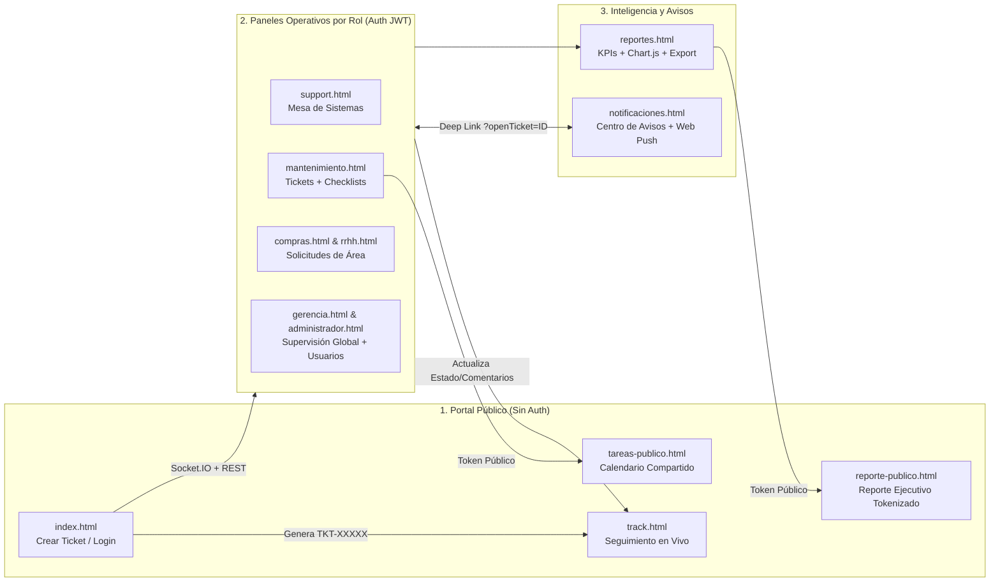

# Feature UX/UI Specification — Ecosistema Global TicketHTML (Imagen Diagnóstica)

> **Estado:** Pendiente de Aprobación (GATE 1)  
> **Alcance:** Proyecto Completo (`4` Vistas Públicas + `8` Vistas Privadas + Librería Central `core-panel.js` + Sistema de Diseño `design-system.css`)  
> **Design System vinculado:** [`.stitch/DESIGN.md`](file:///c:/Coding/TicketHTML/.stitch/DESIGN.md)

---

## 0. Hallazgos de la Fase 1 (Auditoría del Estado Actual)

Tras auditar las 12 vistas HTML, las 10 hojas CSS y los 14 módulos JS del proyecto, se identificaron las siguientes deudas críticas de UX/UI y Accesibilidad:

1. **Estilos Inline y Fragmentación de Tokens**:
   - [`public/index.html`](file:///c:/Coding/TicketHTML/public/index.html), [`public/track.html`](file:///c:/Coding/TicketHTML/public/track.html), [`public/tareas-publico.html`](file:///c:/Coding/TicketHTML/public/tareas-publico.html), [`public/reporte-publico.html`](file:///c:/Coding/TicketHTML/public/reporte-publico.html) y [`private/notificaciones.html`](file:///c:/Coding/TicketHTML/private/notificaciones.html) contienen bloques `<style>` inline con colores hardcodeados (`#2c3e50`, `#f8f9fa`, `#e9ecef`, `#dc3545`, `#ffc107`, `#6c757d`, `#333`) que rompen la sincronización con `html[data-theme="dark"]`.
   - En [`public/js/index.js`](file:///c:/Coding/TicketHTML/public/js/index.js#L81-L129), los contadores de caracteres aplican colores hexadecimales por JS (`style.color = "#dc3545"`) en lugar de clases semánticas.
   - En [`private/gerencia.html`](file:///c:/Coding/TicketHTML/private/gerencia.html#L115-L150) y [`private/compras.html`](file:///c:/Coding/TicketHTML/private/compras.html#L93-L131), existen atributos `style="..."` inline en selectores y contenedores de búsqueda que fuerzan fondos claros (`#f8f9fa`).
2. **Desconexión de `core-panel.js` en Vistas Públicas**:
   - Las 4 vistas públicas no importan [`/js/core-panel.js`](file:///c:/Coding/TicketHTML/public/js/core-panel.js), duplicando lógica de modo oscuro (`ThemeManager`), lightbox (`openTrackLightbox` en `track.html` sin estado de error ni spinner) y careciendo del gestor de foco y bloqueo de scroll (`ModalScrollLock` + `trapFocusInModal`).
3. **Inconsistencias de Prioridad `urgent` y Navegación**:
   - El filtro `#priorityFilter` en [`private/administrador.html`](file:///c:/Coding/TicketHTML/private/administrador.html#L158), [`private/support.html`](file:///c:/Coding/TicketHTML/private/support.html#L109), [`private/mantenimiento.html`](file:///c:/Coding/TicketHTML/private/mantenimiento.html#L110), [`private/compras.html`](file:///c:/Coding/TicketHTML/private/compras.html#L102) y [`private/rrhh.html`](file:///c:/Coding/TicketHTML/private/rrhh.html#L97) omite la opción `urgent` (`🔴 Urgente`), mientras que en [`core-panel.js`](file:///c:/Coding/TicketHTML/public/js/core-panel.js#L733) (`buildVerticalTicketCard`, `buildKanbanCard`, `buildGridTicketCard`) el ternario de prioridad solo evalúa `high` y `medium`, renderizando tickets `urgent` como `🟢 Baja`.
   - En [`private/notificaciones.html`](file:///c:/Coding/TicketHTML/private/notificaciones.html#L647), hacer clic en una notificación siendo rol `gerencia` redirige a `/admin` (ruta inexistente/errónea) en vez de `/gerencia`.
4. **Brechas de Accesibilidad (WCAG 2.2 AA)**:
   - Ausencia de enlace `.skip-link` ("Saltar al contenido principal") y de landmarks semánticos (`<header>`, `<nav>`, `<main id="main-content">`) en paneles privados.
   - Inputs de [`public/index.html`](file:///c:/Coding/TicketHTML/public/index.html#L918-L1032) sin asociación `aria-describedby` hacia sus contenedores `.field-error` ni conmutación de `aria-invalid="true"`.
   - Controles de filtrado (`#priorityFilter`, `#startDateFilter`, `#endDateFilter`, `#sortFilter`, `#searchInput`) sin `aria-label` explícito en `support.html`, `mantenimiento.html`, `gerencia.html`, `compras.html` y `rrhh.html`.
   - Pestañas `.maint-tabs-container` en `support.html`, `gerencia.html` y `mantenimiento.html` sin `role="tablist"`, `role="tab"`, `aria-selected` ni `aria-controls`.
   - Tarjetas `.ticket-grid-card` y `.ticket-card-vertical` en [`core-panel.js`](file:///c:/Coding/TicketHTML/public/js/core-panel.js#L723) tienen `role="button"` y `tabindex="0"`, pero carecen de handler `onkeydown` para `Enter`/`Space` y anidan `<button class="btn-quick-action">` dentro de un elemento con `role="button"`.
   - Ítems `.notification-item` en [`private/notificaciones.html`](file:///c:/Coding/TicketHTML/private/notificaciones.html#L582) carecen de `tabindex="0"`, `role="button"` y soporte de teclado.
   - Elementos `<canvas>` de Chart.js en [`private/reportes.html`](file:///c:/Coding/TicketHTML/private/reportes.html#L196) y [`public/reporte-publico.html`](file:///c:/Coding/TicketHTML/public/reporte-publico.html#L539) carecen de `role="img"` y `aria-label`.

---

## 1. User Flow & JTBD (Jobs To Be Done) por Macro-Flujo



### 1.1. Flujo 1: Portal Público de Ingreso y Seguimiento (`public/index.html`, `public/track.html`)
- **JTBD**: *"Cuando ocurre un desperfecto en un equipo médico, PC o instalación de mi sede, quiero reportarlo en menos de 60 segundos sin necesitar una cuenta y obtener un código de seguimiento verificable en tiempo real."*
- **Jerarquía Visual**:
  1. **Primaria**: Formulario compacto de creación de ticket (6 campos esenciales + adjuntos drag/click + CTA `"🚀 Crear y Enviar Ticket"`) en `index.html`; Estado actual del ticket y línea de tiempo de respuestas en `track.html`.
  2. **Secundaria**: Buscador rápido de código `TKT-XXXXX` en la cabecera superior y modal de confirmación con botón `"📋 Copiar Número"`.
  3. **Terciaria**: Acceso `"🔐 Iniciar Sesión"` para personal interno y conmutador de tema (`🌙/☀️`).

### 1.2. Flujo 2: Mesa Operativa de Gestión de Tickets (`support.html`, `gerencia.html`, `administrador.html`, `compras.html`, `rrhh.html`)
- **JTBD**: *"Como responsable o técnico de área, quiero visualizar de un vistazo qué tickets urgentes o pendientes requieren acción inmediata, filtrarlos por sede/fecha/búsqueda, cambiar su estado con un clic y documentar la resolución notificando al solicitante."*
- **Jerarquía Visual**:
  1. **Primaria**: Pestañas de estado (`🟡 Pendientes`, `🔵 En Progreso`, `🟢 Cerrados`) con contadores vivos + Grilla `3x5` de tarjetas de tickets con píldoras de prioridad (`🔴 Urgente`, `🟠 Alta`, `🟡 Media`, `🟢 Baja`) y acciones rápidas inline.
  2. **Secundaria**: Barra de filtros combinables (Ámbito, Prioridad, Rango de Fechas, Ordenamiento y Búsqueda instantánea) + Modal de detalle de ticket con historial y formulario de respuesta.
  3. **Terciaria**: Tarjetas superiores de resumen KPI (`#statsGrid`), paginación universal y exportación a CSV.

### 1.3. Flujo 3: Mantenimiento Preventivo, Checklists y Calendario (`mantenimiento.html`, `tareas-publico.html`)
- **JTBD**: *"Como equipo de Mantenimiento o Sistemas, quiero planificar rutinas preventivas recurrentes y tareas programadas en vistas de Mes, Semana Laboral, Semana Completa o Agenda, verificando ítems de checklist y compartiendo un enlace público de solo lectura con dirección."*
- **Jerarquía Visual**:
  1. **Primaria**: Matriz de calendario interactivo (`Mes` / `Sem. Laboral` / `Semana` / `Agenda`) con tarjetas codificadas por estado y progreso de checklist (`3/5 completados`).
  2. **Secundaria**: Barra de herramientas del calendario (`Hoy`, navegación `◀ ▶`, selector de vista, botón `"➕ Nueva Tarea"`, `"🔗 Compartir"` y filtros por categoría/sede).
  3. **Terciaria**: KPIs superiores de tareas (Total, Pendientes, En Progreso, Completadas, Recurrentes Activas).

### 1.4. Flujo 4: Reportes Ejecutivos y Centro de Notificaciones (`reportes.html`, `reporte-publico.html`, `notificaciones.html`)
- **JTBD**: *"Como Gerencia o Administración, quiero analizar la tasa de resolución, tiempos promedio y cuellos de botella por departamento/sede, exportar informes en PDF/CSV o compartir un enlace en vivo, y atender alertas críticas sin perder contexto."*
- **Jerarquía Visual**:
  1. **Primaria**: Tarjetas KPI con variación porcentual + Gráficos interactivos Chart.js (Tendencia temporal, Distribución por departamento/estado/prioridad) en `reportes.html`; Lista priorizada de avisos no leídos en `notificaciones.html`.
  2. **Secundaria**: Tabla comparativa de rendimiento por departamento (responsiva a tarjetas en móvil) y selector de período (`24h`, `7d`, `30d`, `90d`, `180d`, `365d`).
  3. **Terciaria**: Acciones de exportación (`CSV`, `PDF`, `Compartir enlace`) y gestión de enlaces compartidos activos.

---

## 2. Matriz de Estados de UI (Contrato Visual Exhaustivo)

### 2.1. Initial / Loading State (Cero Pantalla en Blanco / Cero CLS)
- **Eliminación de bloqueo visual opaco**: Se reemplaza el patrón `<body style="visibility: hidden; opacity: 0;">` por la visualización inmediata de la estructura base (App Shell) con **Skeletons pre-renderizados** mientras `verifySession()` y `loadTickets()` resuelven en paralelo.
- **Dimensiones Exactas de Skeletons (`design-system.css` + `core-panel.js`)**:
  - **KPI Skeleton Card (`.skeleton-stat-card`)**: Altura fija `104px`, `border-radius: var(--radius-lg)`, conteniendo un bloque numérico (`width: 48%; height: 28px; margin-bottom: 8px`) y etiqueta (`width: 70%; height: 14px`). Se inyectan `4` tarjetas en `#statsGrid` al iniciar.
  - **Ticket Grid Skeleton (`window.renderSkeletonTicketGrid(6)`)**: Grilla `.tickets-grid-3x5` con `6` tarjetas `.skeleton-card` de `min-height: 210px`, título (`height: 18px; width: 68%`), `2` badges (`width: 72px; height: 22px; border-radius: 999px`), `2` líneas de descripción (`height: 12px; width: 100%` y `80%`) y pie de metadatos (`height: 12px; width: 50%`).
  - **Table Skeleton (`window.renderSkeletonTableRows(cols, 5)`)**: `5` filas con celdas `.skeleton-line` (`height: 14px`) para tablas de usuarios, reportes y enlaces compartidos.
  - **Modal / Timeline Skeleton (`window.renderSkeletonDetails()`)**: Contenedor con `role="status" aria-busy="true"` para carga de detalles de ticket o historial de notificaciones.

### 2.2. Empty State (Orientado a la Acción)
- **Estructura Estándar (`.empty-state-box`)**:
  - Contenedor centrado (`padding: 40px 24px`, `border: 1px dashed var(--color-border-strong)`, `border-radius: var(--radius-lg)`, `background: var(--color-surface-elevated)`).
  - **Ícono semántico**: `48px` (`📭` para bandeja limpia, `🔍` para búsqueda sin coincidencias, `🔔` para sin notificaciones, `📅` para agenda sin tareas).
  - **Título (`h3`)**: Conciso y contextual (ej. `"No hay tickets pendientes con estos filtros"`).
  - **Copy secundario (`p`)**: Explicación clara de por qué la vista está vacía.
  - **CTA Obligatorio cuando hay filtros activos**: Si el usuario tiene texto en `#searchInput`, prioridad seleccionada o fechas activas, se renderiza automáticamente el botón `<button type="button" class="btn btn-outline btn-sm" onclick="window.resetAllTicketFilters()">🔄 Limpiar filtros activos</button>`.

### 2.3. Error / Edge States (Validación Inline, Red y Fallbacks)
- **Validación Inline de Formularios (`index.html`, modales de tareas y usuarios)**:
  - Activación en evento `blur` y limpieza inmediata en `input` al corregir el valor.
  - Borde del campo en `var(--color-danger)`, `aria-invalid="true"` y contenedor `.field-error.show` con ícono `⚠️`, color `var(--color-danger-text)` y `role="alert"`.
  - Contadores de caracteres (`title`: máx. `200`, `description`: máx. `2000`): Barra de progreso que cambia mediante clases CSS (`.is-warning` al superar el `75%` usando `var(--color-warning)` y `.is-danger` al superar el `90%` usando `var(--color-danger)`), prohibiendo colores inline en JS.
- **Fallos de Red / Rate Limiting (`429`) / Caída de Socket.IO**:
  - Si `apiFetch()` recibe `429`, muestra toast `warning` no intrusivo sin cerrar la sesión del usuario.
  - Si falla la carga inicial de una lista (`#ticketsList`, `#notificationsList`, `#reportTableBody`), se renderiza un `.error-state-box` con mensaje claro y botón `<button type="button" class="btn btn-primary btn-sm" onclick="retryLoad()">🔄 Reintentar carga</button>`.
  - Si `Socket.IO` pierde conexión (o en entorno Serverless Vercel), `window.TicketRefresh` conmuta automáticamente al heartbeat HTTP silencioso y refresca al recuperar visibilidad (`visibilitychange`).

### 2.4. Ideal / Populated State (Truncado, Grilla y Paginación)
- **Límites de Truncado en Tarjetas (`.ticket-grid-card`)**:
  - `.ticket-title`: Máximo `2 líneas` (`display: -webkit-box; -webkit-line-clamp: 2; -webkit-box-orient: vertical; overflow: hidden`) con atributo `title` completo.
  - `.ticket-description`: Máximo `2 líneas` (`-webkit-line-clamp: 2`) en grilla `3x5` y `140 caracteres` en tarjetas verticales.
  - Metadatos (`Sede`, `Depto`, `Solicitante`, `Asignado`): `1 línea` con `text-overflow: ellipsis` para garantizar que todas las tarjetas de una misma fila mantengan altura uniforme.
- **Paginación y Scroll**:
  - Vista de pestañas en grilla: `15 tickets por página` (`3 columnas x 5 filas` en desktop, `2x8` en tablet, `1x15` en móvil) gobernada por `window.renderUniversalPagination()`.
  - Modales con cuerpo desplazable (`max-height: 80vh; overflow-y: auto; overscroll-behavior: contain`) y bloqueo de scroll del documento raíz mediante `window.ModalScrollLock`.

---

## 3. Contrato de Accesibilidad (a11y Spec — WCAG 2.2 AA)

### 3.1. Landmarks y Orden de Tabulación (`tabIndex`)
1. **Skip Link universal**: Primer hijo del `<body>` en las 12 vistas:
   ```html
   <a href="#main-content" class="skip-link">Saltar al contenido principal</a>
   ```
2. **Estructura Semántica**:
   - `<header class="navbar">` (o `.header` / `.public-navbar`) para la cabecera superior.
   - `<main id="main-content" tabindex="-1">` envolviendo el contenedor principal de cada vista.
3. **Secuencia lógica de foco (`tabindex="0"` nativo, sin valores positivos `tabindex > 0`)**:
   - `Skip Link` → `Logo (Inicio)` → `Navegación / Reportes` → `Conmutador de Tema (aria-pressed)` → `Campana de Notificaciones (aria-expanded)` → `Cerrar Sesión` → `Pestañas de Vista (role="tablist")` → `Barra de Filtros y Buscador` → `Pestañas de Estado de Tickets (role="tablist")` → `Tarjetas de Tickets y Acciones Rápidas` → `Paginación`.

### 3.2. Manejo de Foco (`:focus-visible` y Modales)
- Ningún control interactivo puede eliminar el outline sin proveer `:focus-visible`:
  ```css
  :focus-visible {
    outline: 2px solid var(--color-focus-ring);
    outline-offset: 2px;
    box-shadow: var(--shadow-focus);
  }
  ```
- **Ciclo de Vida del Foco en Modales (`core-panel.js`)**:
  - Al abrir cualquier modal (`#ticketModal`, `#loginModal`, `#trackingModal`, `#taskModalDialog`, `#userModal`, `#shareReportModal`, `#coreUniversalLightbox`), se guarda `document.activeElement`, se traslada el foco al primer control interactivo (o al botón de cierre) y `trapFocusInModal()` mantiene el ciclo `Tab` / `Shift+Tab` encerrado dentro del diálogo.
  - Al cerrar el modal (vía botón `×`, clic en backdrop o tecla `Escape`), `window.restoreFocusAfterModal()` devuelve el foco exactamente al botón o tarjeta que lo invocó.

### 3.3. Roles ARIA, Asociaciones y Regiones Vivas (`aria-live`)
- **Tarjetas de Ticket sin Anidamiento Interactivo Inválido (WCAG 4.1.2)**:
  - En `buildGridTicketCard()`, el contenedor `.ticket-grid-card` utiliza `<article class="ticket-item ticket-grid-card ...">` y el título/cuerpo principal actúa como disparador accesible con `tabindex="0"`, `role="button"`, `aria-label="Ver detalles del ticket TKT-XXXXX: [Título]"` y soporte de teclado `onkeydown` (`Enter` y `Space`), mientras que `.ticket-quick-actions` queda como barra hermana dentro del `<article>`, evitando botones dentro de un `role="button"`.
- **Pestañas Accesibles (`role="tablist"`)**:
  - Tanto `.maint-tabs-container` (vistas de Tickets vs Tareas/Usuarios) como `.ticket-tabs-container` (estados `Pendientes` / `En Progreso` / `Cerrados`) implementan `role="tablist"`, botones con `role="tab"`, `aria-selected="true|false"` y soporte para flechas `ArrowLeft` / `ArrowRight`.
- **Región Viva de Estado (`aria-live="polite"`)**:
  - Se incorpora un anunciador global `#a11yStatusAnnouncer` (`class="visually-hidden" aria-live="polite" aria-atomic="true"`) en `core-panel.js` que anuncia cambios al filtrar o paginar (ej. *"Mostrando 12 tickets pendientes, página 1 de 1"*).
- **Gráficos Accesibles (`Chart.js`)**:
  - Todo `<canvas>` en `reportes.html` y `reporte-publico.html` incluye `role="img"` y un `aria-label` descriptivo actualizado dinámicamente con el resumen de los datos graficados.

### 3.4. Atajos de Teclado Estándar
| Tecla / Combinación | Contexto | Acción |
| :--- | :--- | :--- |
| `Tab` / `Shift + Tab` | Global / Modales | Avanza o retrocede por los elementos interactivos; dentro de un modal abierto aplica *Focus Trap*. |
| `Escape` | Modales / Lightbox / Dropdown Notificaciones / Menú Contextual | Cierra el diálogo, visor de imagen o menú flotante superior y devuelve el foco al elemento disparador. |
| `Enter` o `Space` | Tarjetas `.ticket-item`, `.notification-item`, botones | Abre el modal de detalle del ticket/notificación o ejecuta la acción del botón. |
| `ArrowRight` / `ArrowLeft` | Pestañas (`role="tablist"`) | Desplaza el foco y activa la pestaña siguiente o anterior de forma circular. |

---

## 4. Arquitectura de Componentes (Validada con Context7)

Dado que el stack de producción en [`package.json`](file:///c:/Coding/TicketHTML/package.json) es **Vanilla HTML5 + CSS3 Custom Properties + ES6+ JavaScript** sobre **Node.js / Express `^4.22.2`**, **Socket.IO `^4.8.3`** y **Chart.js `4.4.1`**, la arquitectura se organiza en primitivas reutilizables centralizadas en [`public/js/core-panel.js`](file:///c:/Coding/TicketHTML/public/js/core-panel.js) y [`public/css/design-system.css`](file:///c:/Coding/TicketHTML/public/css/design-system.css):

| Componente / Primitiva | Ubicación | API / Props / Firma | Validación Técnica (Context7) |
| :--- | :--- | :--- | :--- |
| **`ThemeManager`** | `public/js/core-panel.js` (cargado en las 12 vistas) | `ThemeManager.getTheme()`, `ThemeManager.setTheme('light'\|'dark')`, `ThemeManager.toggle()` | Sincroniza `html[data-theme]`, `localStorage('ticket_theme')`, `aria-pressed` en `#themeToggleBtn` e invoca `chart.update('none')` (API oficial de **Chart.js v4** `/websites/chartjs` sin re-animación costosa). |
| **`TicketRefresh`** | `public/js/core-panel.js` | `TicketRefresh.register(fn)`, `TicketRefresh.unregister()`, `TicketRefresh.trigger()` | Basado en eventos de cliente **Socket.IO v4** (`/websites/socket_io_v4`: `connect`, `disconnect`, `ticket_updated`) con debounce de `800ms` y fallback HTTP de `5 min` para entornos Serverless (Vercel). |
| **`ModalScrollLock` & `FocusTrap`** | `public/js/core-panel.js` | `ModalScrollLock.lock()`, `ModalScrollLock.unlock()`, `restoreFocusAfterModal()` | Observador `MutationObserver` sobre diálogos (`role="dialog" aria-modal="true"`), compensación de `scrollbarWidth` para evitar Layout Shift y encierro de tabulación WCAG 2.2 AA. |
| **`renderTabbedTicketView`** | `public/js/core-panel.js` | `(containerId, filteredTickets, activeTab, tabPages, onTabChangeFn, onPageChangeFn, isReadOnly)` | Renderiza `role="tablist"` con contadores por estado, grilla `3x5` (`buildGridTicketCard` con soporte completo para prioridad `urgent`, `high`, `medium`, `low`), estados vacíos con CTA `"Limpiar filtros"` y anuncio en `#a11yStatusAnnouncer`. |
| **`renderSkeletons`** | `public/js/core-panel.js` | `renderSkeletonStats(count)`, `renderSkeletonTicketGrid(count)`, `renderSkeletonTableRows(cols, rows)`, `renderSkeletonDetails()` | Primitivas de carga iniciales libres de CLS con `role="status"` y `aria-busy="true"`. |
| **`A11yFormValidator`** | `public/js/core-panel.js` & `public/js/index.js` | `setFieldError(inputEl, errorEl, msg)`, `clearFieldError(inputEl, errorEl)` | Vincula automáticamente `aria-invalid="true\|false"` y `aria-describedby` entre cualquier `<input>/<select>/<textarea>` y su `.field-error`. |

---

## 5. Prompts Optimizados para Stitch MCP

Los siguientes bloques están listos para ser enviados a **Stitch MCP** (`generate_screen_from_text` / `upload_design_md`) siguiendo estrictamente los tokens de [`.stitch/DESIGN.md`](file:///c:/Coding/TicketHTML/.stitch/DESIGN.md):

### 5.1. Prompt Stitch — Vista 1: Portal Público de Creación y Rastreo (`public/index.html`)
```text
Design a clean, clinical-grade Public Support Ticket Portal for "Imagen Diagnóstica" (medical imaging center) in Desktop (1440x900) and Mobile (390x844) following our DESIGN.md tokens.
- Brand & Theme: Primary institutional teal (#008B8B / #006B6B gradient backdrop in light mode, #0F172A / #1E293B in dark mode), Montserrat font family, high-contrast Slate text (#0F172A on #FFFFFF surfaces), 12px card radius, pill buttons (9999px radius).
- Top Header Bar: Floating white/dark-slate card with "Imagen Diagnóstica - Sistema de Tickets" logo on the left; inline Ticket Tracking search input ("Rastrear ticket ej: TKT-12345" + "Rastrear" button), Dark/Light mode toggle button, and "Iniciar Sesión" primary pill button on the right.
- Main Content Card: Single-screen ergonomic form card titled "Crear Nuevo Ticket".
  - Top 3-column responsive grid: 1) Nombre y Apellido, 2) Email, 3) Área Afectada / Servicio, 4) Sede (select: Ciudad, Maipú, San Martín), 5) Dirigido al Área (select: Sistemas, Mantenimiento, Compras e Insumos, Gerencia), 6) Asunto del Problema (with live 0/200 character counter and semantic progress bar).
  - Bottom split grid (62% / 38%): Detailed Description textarea (with 0/2000 counter and progress bar) on the left; Drag-and-drop / button Image Attachment uploader ("Subir Fotos - Máx 3, 20MB" with 3 thumbnail preview slots) on the right.
  - Footer: Prominent centered primary gradient CTA button "Crear y Enviar Ticket".
```

### 5.2. Prompt Stitch — Vista 2: Panel Operativo de Gestión de Tickets (`private/support.html` / `private/gerencia.html`)
```text
Design an enterprise Helpdesk & Operations Dashboard for "Imagen Diagnóstica" in Desktop (1440x900) following DESIGN.md tokens.
- Top Navbar: Institutional teal gradient (#008B8B to #006B6B) with brand logo, view title "Panel de Soporte / Gerencia", "Reportes" button, active user badge, Dark/Light mode toggle, Notification Bell with unread counter badge and dropdown preview, and "Cerrar Sesión" button.
- Top View Switcher Tabs: Pill tablist switching between "Mis Tickets Asignados (14)" and "Tablero de Tareas & Calendario (8)".
- KPI Summary Row: 4 elevated stat cards (12px radius) showing Total Tickets, Pendientes (amber #B45309), En Progreso (sky blue #0369A1), and Cerrados (emerald #15803D).
- Filter & Search Toolbar: Elevated surface bar with Scope selector ("Mis Tickets" / "Todos"), Priority select (Urgente, Alta, Media, Baja), Date Range inputs (Desde -> Hasta + Clear button), Sort selector, and full-width instant search input.
- Status Tabs + 3x5 Ticket Grid:
  - Status sub-tabs: "Pendientes (6)", "En Progreso (3)", "Cerrados (5)".
  - 3-column grid of Ticket Cards: Each card displays a left priority accent border, 2-line truncated title, semantic status pill, priority pill (Urgente/Alta/Media/Baja), tracking ID chip (TKT-00142), relative timestamp, 2-line description preview, metadata grid (Sede, Depto, Solicitante, Técnico Asignado badge), and 2 quick-action footer buttons ("En Progreso", "Cerrar").
  - Bottom universal pagination bar ("Mostrando 1-15 de 42 tickets").
```
